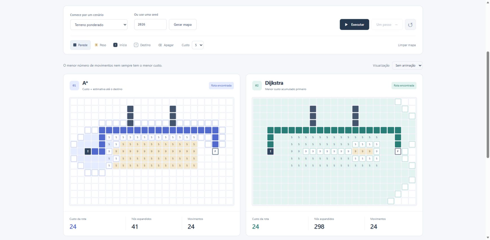

# Verification

Reviewed on November 1, 2026. [CI](https://github.com/LercZin/pathfinding-lab/actions/workflows/ci.yml) records its own source revision and result.

## Automated local checks

- **42 tests passed**, including A*/Dijkstra agreement on 48 seeded maps, known optimal costs, unreachable routes, deterministic behavior and timer cancellation.
- TypeScript, Oxlint, formatting and the Vite production build passed.
- Sparse cost/wall arrays are rejected; regression tests cover the validation boundary.

## Edge walkthrough of the production build

| Scenario                | Observed result                                                                          |
| ----------------------- | ---------------------------------------------------------------------------------------- |
| Corridors preset        | Both algorithms returned cost 32; A* expanded 170 nodes and Dijkstra 306.                |
| Weighted preset         | Both returned cost 24 and 24 moves; A* expanded 41 nodes and Dijkstra 298.               |
| Isolated goal           | Both reported no route and expanded 332 nodes.                                           |
| Keyboard navigation     | ArrowRight moved grid focus from row 1/column 1 to column 2.                             |
| Keyboard editing        | Space changed the selected cell in both views and cleared old results.                   |
| Editing during playback | The active search was canceled; metrics stayed cleared after waiting through later work. |

The comparison was exercised with the actual built interface in Edge. These particular expansion counts describe these presets and tie-breaking rules; they are not a general claim that A* always expands fewer nodes or a CPU benchmark.

The test suite uses deterministic data and fake timers for lifecycle checks. No full browser automation suite, mobile-device certification or production routing service is claimed.
